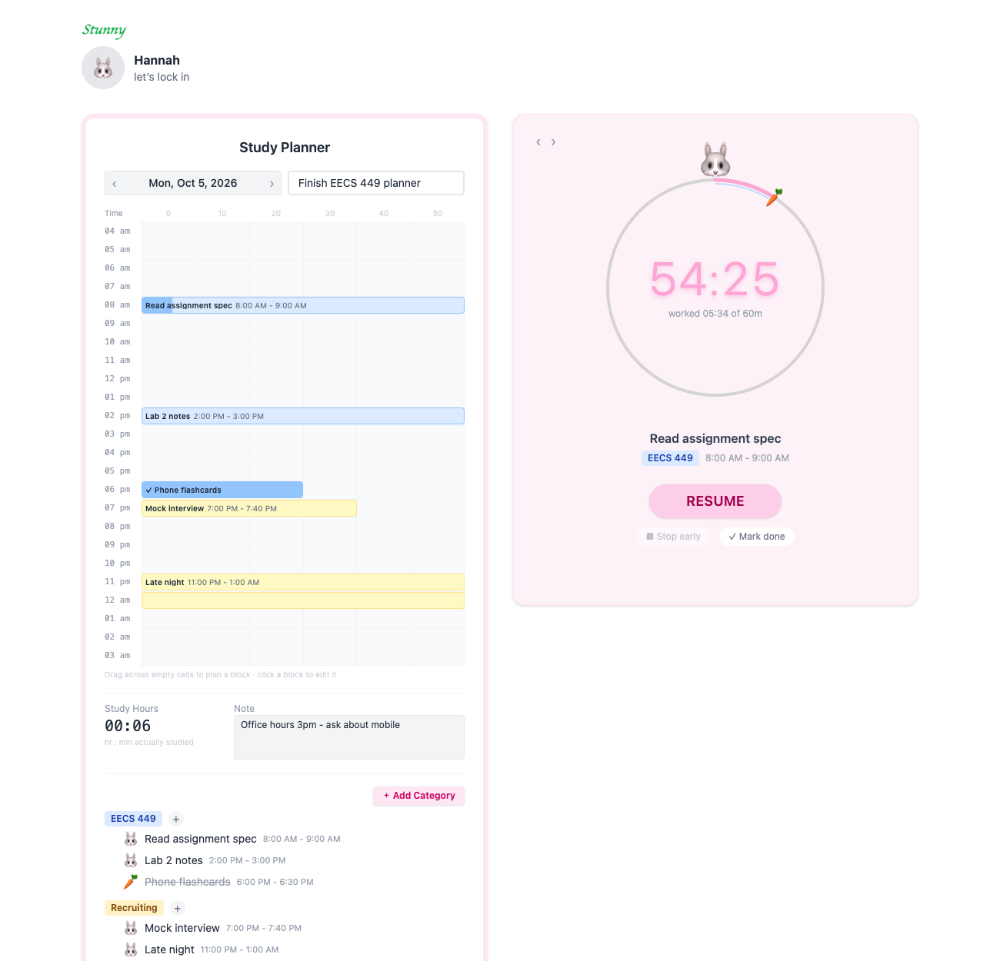
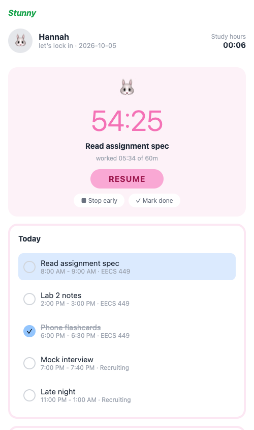

# Stunny: a time-block study planner in Jac

**Name:** Hannah Lee
**UMID:** _TODO: add UMID_
**Course:** EECS 449, Assignment 1 (Personal Planning App in Jac)

Stunny is the study planner I actually use: a paper-planner style day sheet
with a 4 AM – 4 AM timetable in 10-minute cells, plus a study timer that
records how long I *really* studied. You plan blocks on the web, run the timer
from the web or your phone, and add or check off tasks from the terminal. All
three clients read and write the same data on one Jac server.



---

## Main features

| | |
|---|---|
| **Daily planner card** | Date (with ‹ › day navigation), daily goal, notes, all saved per day on the server. |
| **4 AM – 4 AM timetable** | 24 hour-rows × six 10-minute cells. A block that crosses midnight (11 PM – 1 AM) stays one task. |
| **Drag to create** | Click and drag across cells. The selection highlights, then the Add Task modal opens with start/end pre-filled. |
| **Categories** | Create, rename, recolor (yellow, pink, green, blue, purple, orange, with a check-mark indicator), and delete with confirmation (deletes its tasks). Recoloring re-tints every block. |
| **Tasks** | Add from a category's ＋ or by dragging. Click any block to edit the title or times, or to delete it (with confirmation). Validation: title required, end after start, duration > 0, and **no overlapping blocks**. |
| **Study timer** | Start / pause / resume / stop early / mark done. It counts down the task's planned length and shows a progress ring with a carrot 🥕 at the worked point. |
| **Exact timing** | Elapsed time is derived from timestamps, so it stays correct across throttled tabs, sleep, reloads, and devices (details below). |
| **Auto-complete** | When the timer reaches the planned duration it stops, marks the task complete, and logs the session, even if no browser is open. |
| **Study Hours = real work** | Sum of logged timer sessions, never the sum of scheduled durations. (60 min completed + 25 min stopped early = **01:25**.) |
| **Partial highlighting** | A completed block is filled in its category color. A partially worked block is filled only for the worked portion (8:00–8:45 of an 8:00–10:00 block). |
| **Mobile app** | Today's list, tap-to-complete, the full timer, and quick add. |
| **CLI** | `today`, `add`, `timer start/pause/stop/toggle`, `done`/`undo`, `category list/add`. |
| **Live sync** | The web and mobile clients poll every 4 s and refresh when the tab regains focus, so a task added from the terminal appears on the timetable within seconds. |

---

## Prerequisites

* The **Jac CLI, version 0.37.23** (`jac --version`). Install it following
  <https://jaclang.org/docs/latest>. The project pins `jac-version = "==0.37.23"`.
* Nothing else for the web app and CLI. Jac bundles its own JS tooling (Bun/Vite),
  and npm packages install automatically on the first `jac run`.
* For the mobile app **on a device or simulator only**: the Expo Go app on your phone,
  or Android SDK / Xcode (see [Mobile](#mobile-app)). The browser preview needs nothing extra.

## Run the web app and server

From the repository root:

```bash
jac run
```

Open **<http://localhost:8000>**. `jac run` serves the default app (`web`), and the
`planner` service app is colocated in the same process. Data is persisted by the Jac
runtime under `.jac/data/` (git-ignored), so everything survives restarts and refreshes.

Quick tour:
1. **＋ Add Category** → name it (e.g. `EECS 449`) and pick a color.
2. **Drag** down/across empty timetable cells (e.g. 8:00 → 8:50) → type a title → **DONE**.
3. On the right, press **START**. Watch the ring fill and the block on the timetable fill in.
4. **PAUSE** / **RESUME**, **Stop early** (keeps the time, not completed), or let it run out (auto-complete).
5. Click any block to edit or delete it. Click a category chip to rename, recolor, or delete it.

## CLI

The CLI talks to the running server (start `jac run` first, in another terminal).

```bash
jac run cli -- --help
jac run cli -- today                                   # today's plan, timers, study hours
jac run cli -- category add "EECS 449" --color pink    # new category
jac run cli -- category                                # list categories
jac run cli -- add "Read spec" -c "EECS 449" -s 09:00 -e 10:00
jac run cli -- add "Leetcode" -c recruiting -s 23:00 -e 00:30   # crosses midnight, fine
jac run cli -- timer start 1        # task number from `today`…
jac run cli -- timer pause spec     # …or a unique part of its title
jac run cli -- timer stop 1         # stop early: keep worked time, not completed
jac run cli -- done 2               # mark completed   (undo 2 to reopen)
```

Tip: `alias stunny="jac run cli --"` then `stunny today`.

Example output:

```
🐰 Stunny · 2026-10-05
   Study hours: 01:25

 1. ✅ 8:00 AM - 9:00 AM    🩷 Read assignment spec  [EECS 449]  60:00 / 60m
 2. ⏹  10:00 AM - 11:00 AM  🩷 Lab 2 notes  [EECS 449]  25:00 / 60m
 3. ⏱  2:00 PM - 3:00 PM    🟨 Mock interview  [Recruiting]  03:12 / 60m  (running)
```

The server address defaults to `http://localhost:8000`. Point the CLI elsewhere with
`STUNNY_SERVER=http://<host>:8000 jac run cli -- today`. If the server is down, the CLI
prints a hint and exits with code 3.

## Mobile app

The mobile app (`mobile/`) is a Jac mobUI app: one source compiles to native React
Native views (Expo) and to a browser build (react-native-web). Like every Jac mobile
app it is frontend-only. Its calls go to the `planner` service, so it shares the same
data as the web app and CLI.

**Option A: browser preview (no phone or SDK needed).** Use two terminals:

```bash
# terminal 1: web app + server, served from its built bundle
jac run --no-dev
# terminal 2: the phone UI in a browser
jac run --dev --platform web --port 8100 mobile
```

Open **<http://localhost:8100>** (use your browser's device toolbar for a phone-sized
view). Terminal 1 uses `--no-dev` because two Jac dev servers in one project share
`.jac/client/` and would overwrite each other's page. If you don't need the web app
at the same time, `jac run --dev --platform web mobile` alone also works.

**Option B: on a real phone or simulator.**

```bash
jac run                    # terminal 1: web app + server
jac run --dev mobile       # terminal 2: first run scaffolds the Expo project in .jac/mobile-rn/
```

Then press `a` (Android emulator) or `i` (iOS simulator), or scan the QR code with
**Expo Go** on a phone on the same Wi-Fi. The dev command injects your computer's LAN
address as the API URL. Native builds: `jac build mobile --platform android` (Jac
provisions the Android SDK) or `--platform ios` (needs Xcode).



What you can do on the phone:
- See today's plan and study hours. Tap a task to focus it in the timer.
- **START / PAUSE / RESUME**, **Stop early**, **Mark done** (same server timer as the web).
- Tap the circle on a task to mark it done or undone.
- **Quick add**: title, category chip, `HH:MM` start/end → **ADD**.

---

## How the four components fit together

```
                         ┌──────────────────────────────────────────┐
                         │ planner service app   (core/planner.jac) │
   web (browser) ───RPC──▶  def:pub endpoints: get_day, add_task,   │
   mobile (RN)   ─bridge─▶  update_task, start/pause/stop_timer, …  │
   CLI (terminal)─bridge─▶                                          │
                         │  graph (persisted by Jac):               │
                         │    root → Category → Task                │
                         │    root → DayInfo (goal, note per date)  │
                         │    root → StudySession (one per run)     │
                         └──────────────────────────────────────────┘
                 shared pure helpers: core/utils/  (time, timer math, colors)
```

* **`jac.toml` declares four apps**: `planner` (`kind = "service"`), `web`
  (`web-app`, the default app), `mobile` (`mobile`) and `cli` (`cli`).
* **The server is the single source of truth.** Clients never keep their own copy of a
  task. The web `PlannerContext` holds only the latest server snapshot; every action is
  *write, then re-fetch* (call the endpoint, reload the day). No `localStorage`.
* **The same import line means different things per app.** `import from core.planner
  { add_task }` compiles to an in-process call on the server, a typed async RPC stub in
  the browser, and a bridge call over HTTP from the phone and the terminal. Typed objects
  (`TaskView`, `PlannerDay`) arrive as real instances on every client.
* **Shared logic lives once in `core/utils/`.** For example, `time_utils` handles the
  4 AM planner day, labels and validation, and is used by both the server and the web UI.
  The CLI reuses `task_math` and `clock_format`.

## Engineering decisions worth calling out

1. **The timer is derived, not counted.** A task stores `total_elapsed` (seconds banked
   from finished runs) and `timer_started_at` (when the current run began), and
   `elapsed = total_elapsed + (now − timer_started_at)`. The 1-second interval in the
   UI only *re-renders*; it never adds anything. A throttled tab, a closed laptop
   lid, or a reload is exact on the next render. Pausing banks the run, and resuming
   starts a new run on top of the bank.
2. **The server clock is authoritative.** Start/pause timestamps are set on the server.
   Each fetch returns `server_now`, and clients compute their offset from it, so a phone
   whose clock is a minute off still shows the same time as the laptop.
3. **`settle()` makes auto-complete device-independent.** Every server read and write
   first settles any running timer that has reached its planned duration: it banks
   exactly up to the planned length, stops the timer, marks the task complete, and logs
   the session. A timer started from the CLI completes correctly even if no UI is open.
4. **Study hours come from `StudySession` rows.** Each pause, stop or auto-finish logs
   one session. Study hours is their sum for the day, so it reflects real work, and
   deleting a task does not erase time you already studied.
5. **Planner minutes.** Times are stored as minutes from 4:00 AM (0–1440), so an
   11 PM – 1 AM block is the simple range 1140–1260. Duration and the list of covered
   10-minute cells (`time_blocks`) are computed from start/end rather than stored, which
   avoids duplicated state.
6. **The timetable has no per-cell state.** 144 plain cells plus two integers for the
   drag (`dragFrom`, `dragTo`). Task blocks are absolutely positioned overlays computed
   from start/end, split into one segment per hour row, and the worked part is a filled
   inner bar. Moving a task's time moves the block automatically.
7. **One modal design.** Add Task and Edit Task are a single `TaskModal` with a mode,
   and every dialog (task, category, delete confirmation) uses the shared `Modal` frame.
8. **Validation on both sides.** The UI disables Save and explains why. The server
   re-validates (empty title, reversed or zero range, overlap, duplicate category name)
   and returns `ActionResult { ok, error }`, which modals display inline.

## Project layout

```
jac.toml                    four apps: planner (service), web, mobile, cli
core/
  planner.jac               graph nodes, wire views, all def:pub endpoints, timer rules
  utils/time_utils.jac      planner-minute conversions, labels, validation, time_blocks
  utils/timer_utils.jac     elapsed/progress math from timestamps
  utils/task_math.jac       live elapsed + live study hours for TaskView/PlannerDay
  utils/clock_format.jac    MM:SS and HH:MM formatting
  utils/palette.jac         soft category colors (planned / worked / chip / ink)
  utils/*.test.jac          unit tests
web/
  main.jac                  entry: header, PlannerProvider, Sidebar + Timer
  context/PlannerContext.jac  server snapshot, 1 s clock, 4 s poll, all actions
  components/               Sidebar, Timetable, TaskBlock, TaskModal, CategoryModal,
                            DeleteConfirmation, Modal, Timer
mobile/
  main.jac                  phone screen: timer card, today list, quick add
  theme.jac, timer_math.jac
cli/
  main.jac                  argparse commands → bridged planner calls
  render.jac                terminal formatting
```

## Tests and checks

```bash
jac check        # type-checks all four apps
jac test         # unit tests: planner-day time math, timer math, formatting
```

I also verified end to end, against a running server:
- Drag-to-create, edit/move, delete with confirmation, and category recolor on the web.
- A task added from the CLI and the phone appears on the web timetable.
- Pause/resume preserves time.
- A 1-minute task auto-completes at exactly 60 s with no client open.
- Data survives a browser refresh and a server restart.

## Known limitations

* **Single user, no login.** Endpoints are `def:pub`, so all clients share one
  planner. That is deliberate for a personal tool and keeps the CLI and phone setup
  to zero steps. Multi-user support would switch them to `def:protect` (per-user roots).
* **The phone keeps a small copy of the timer math** (`mobile/timer_math.jac`). The
  jac 0.37 mobile bundler would not bundle helper modules that server code also
  imports, so the phone has its own 30-line, dependency-free version of the same formula.
* **Overlapping tasks are rejected** rather than drawn side by side.
